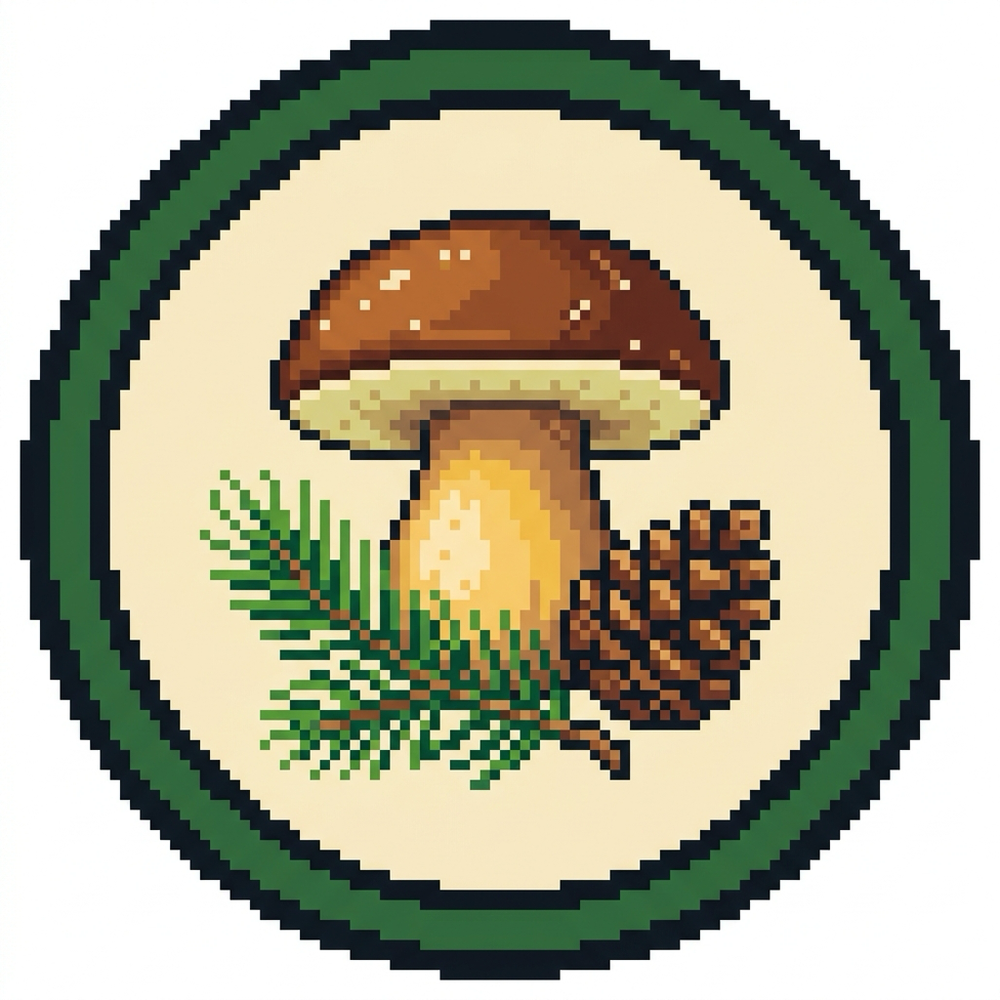

# 🍄 Boscdex

<p align="center">
  
</p>

<p align="center">
  <strong>The 100% offline mushroom forager's Pokédex to explore the Catalan forest</strong>
</p>

<p align="center">
  <a href="https://github.com/jorbush/boscdex/releases"></a>
  <a href="LICENSE"></a>
  <a href="https://flutter.dev"></a>
  <a href="https://dart.dev"></a>
  
  
  
</p>

---

## 🌲 What is Boscdex?

**Boscdex** is a gamified, **100% offline** field companion engineered for mushroom foragers (*boletaires*) and hikers exploring the woods and mountains of Catalonia.

It blends the discovery mechanics of a classic **Pokédex** (collection milestones, silhouette unlocks, rarity tiers, retro achievement badges) with **rigorous field-safety gates** (zero-tolerance lethal lookalike sentinels, interactive botanical verification checklists) and **Catalan ecological lore** (mycorrhizal tree symbiosis, 16-bit retro Catalonia maps, and traditional culinary recipes with local wine pairings).

---

## ✨ Key Features

- **🔌 100% Offline by Design** — Operates entirely deep in the forest without cell reception. All computer vision inference and relational database queries run on-device.
- **🍄 75 Catalan Fungal Taxa** — Comprehensive mycological catalog covering prized delicacies (*Ceps*, *Rovellons*, *Rossinyols*, *Camagrocs*, *Moixernons*, *Tòfones*, *Múrgoles*, *Llenegues*, *Ous de reig*, *Fredolics*), common woodland fungi, and lethal sentinels.
- **📸 Real-Time Edge Machine Learning (Edge ML)** — Quantized MobileNetV2 feature extractor combined with a sub-0.05ms linear classification head executing in native Dart with 3-View Test-Time Augmentation (TTA).
- **⚠️ Zero-Tolerance Life-Safety Gates** — Automatically alerts to lethal lookalikes (*Amanita phalloides*, *A. verna*, *A. virosa*, *Cortinarius orellanus*, *Galerina marginata*, *Gyromitra esculenta*, *Paxillus involutus*, *Inocybe erubescens*) at a 10% sensitivity threshold, triggering mandatory interactive verification checks (`BotanicalSafetyCheckDialog`).
- **🗺️ 16-Bit Retro Catalonia Map ("Mapa de Camp")** — Interactive pixel-art map visualizing species distributions across Catalonia's 7 natural foraging zones (Alt Pirineu, Prepirineu Central, Serralada Transversal i Montseny, Litoral i Prelitoral, Ponent, Serralada Sud i Prades, Ports i Terres de l'Ebre).
- **🛰️ Zero-Cloud Private GPS Geolocation** — Preserves coordinates and altitudinal data exclusively in local SQLite storage. Secret foraging patches (*les clapes*) never leave your device.
- **🍳 Traditional Catalan Recipes & Wine Pairings** — Authentic recipes (*Sopa de fredolics*, *Lleteroles amb all i julivert*, *Arròs de muntanya amb ceps*) with cooking warnings and Catalan wine pairings (DO Priorat, DO Montsant, DO Empordà, DO Terra Alta, DO Penedès).
- **🌲 Indicator Tree Guides** — Guides to key Catalan mycorrhizal host trees (*Pinus sylvestris*, *Pinus halepensis*, *Quercus ilex*, *Fagus sylvatica*, *Castanea sativa*) with on-demand tree classifier.
- **🌐 Trilingual Localization** — Full Catalan (*Català*, default), Spanish (*Castellano*), and English support across all UI navigation, on-device settings, species morphology, safety warnings, and lookalike comparisons.
- **🎖️ Forager Progression & Achievements** — 10-tier experience rank system (*Novell del Bosc* to *Mestre del Bosc*) with 17 collectible retro insignia badges.

---

## 🛠️ Architecture & Tech Stack

| Layer | Technology | Role |
| :--- | :--- | :--- |
| **Framework** | [Flutter](https://flutter.dev) (Dart `>=2.18.0 <4.0.0`) | Cross-platform mobile UI |
| **State Management** | [Riverpod 2.x](https://riverpod.dev) | Declarative reactive dependency injection |
| **Persistence** | [Drift](https://drift.simonbinder.eu/) + SQLite | Reactive, type-safe local database with auto-migration |
| **Computer Vision** | TensorFlow Lite / LiteRT | On-device Edge-ML MobileNetV2 + 3-View TTA |
| **Navigation** | [GoRouter](https://pub.dev/packages/go_router) | Declarative tabbed ShellRoute navigation |
| **Hardware** | `camera`, `geolocator` | Live camera stream and offline GPS coordinates |
| **Audio** | `audioplayers` | 8-bit retro chimes and discovery fanfares |

```
lib/
├── app.dart            # Main MaterialApp and Dark Forest pixel theme configuration
├── main.dart           # App entrypoint with dependency initialization
├── core/               # Constants, GoRouter, pixel theme, trilingual SpeciesLocalizer
├── data/               # Drift database, SQLite tables, DAOs, and seed data
├── domain/             # Domain models, services (ML, safety gate, badges, distribution)
├── presentation/       # Feature screens (Boscdex, Scan, Detail, Journal, Settings)
└── providers/          # Riverpod top-level state providers
```

---

## 🚀 Getting Started

### Prerequisites
- [Flutter SDK](https://flutter.dev/docs/get-started/install) 3.3.3 or compatible
- Dart SDK 2.18.x
- Java 17 + Android SDK 33
- Xcode 14+ (for iOS builds)

### Installation
```bash
# 1. Clone the repository
git clone https://github.com/jorbush/boscdex.git
cd boscdex

# 2. Install dependencies
flutter pub get

# 3. Generate SQLite Drift database code
dart run build_runner build --delete-conflicting-outputs

# 4. Verify static analysis (0 issues)
flutter analyze

# 5. Run automated test suite
flutter test --exclude-tags "ml_benchmark,golden"

# 6. Launch on simulator or device
flutter run
```

### Automation with Make
```bash
make format   # Format Dart code
make lint     # Run static analyzer
make test     # Run all unit and integration tests
make check    # Full CI validation check
```

---

## 🧪 Testing & Quality Standards

Boscdex enforces 100% test pass rates across three validation tiers:
- **Unit Tests (`test/unit_tests/`)**: Domain logic, `SafetyGateService`, `BotanicalSafetyChecklist`, and isolated widget tests.
- **Integration Tests (`test/integration_tests/`)**: In-memory SQLite queries, Drift DAOs, and photo persistence.
- **Golden Tests (`test/unit_tests/presentation/`)**: Pixel-perfect rendering of 16-bit retro components.
- **ML Benchmarks (`test/unit_tests/domain/` & `test/integration_tests/services/`)**: Automated validation on real field images ($N=1,041$, **96.9% Top-1**, **99.3% Top-3**) and curated botanical reference images ($N=75$, **100.0% Top-1 & Top-3**).

---

## 🤝 Contributing

We welcome contributions from mycologists, nature enthusiasts, translators, pixel artists, and developers!

Please read our [**Contributing Guide (CONTRIBUTING.md)**](CONTRIBUTING.md) to get started. All participants are expected to adhere to our [**Code of Conduct (CODE_OF_CONDUCT.md)**](CODE_OF_CONDUCT.md).

For vulnerability or botanical safety disclosures, please see [**SECURITY.md**](SECURITY.md).

---

## ⚠️ Safety & Legal Disclaimer

> **FIELD IDENTIFICATION OF WILD MUSHROOMS CARRIES INHERENT RISKS OF SEVERE POISONING AND DEATH.**  
> This software is provided solely for educational, cultural, and recreational purposes. Computer vision predictions are probabilistic. **NEVER ingest any wild mushroom based on application classifications alone.** Always cross-reference with official botanical keys and consult a certified mycologist.

---

## 📄 License

This project is licensed under the **GNU General Public License v3.0 (GPLv3)**.  
See the [**LICENSE**](LICENSE) file for the full license text and terms.
