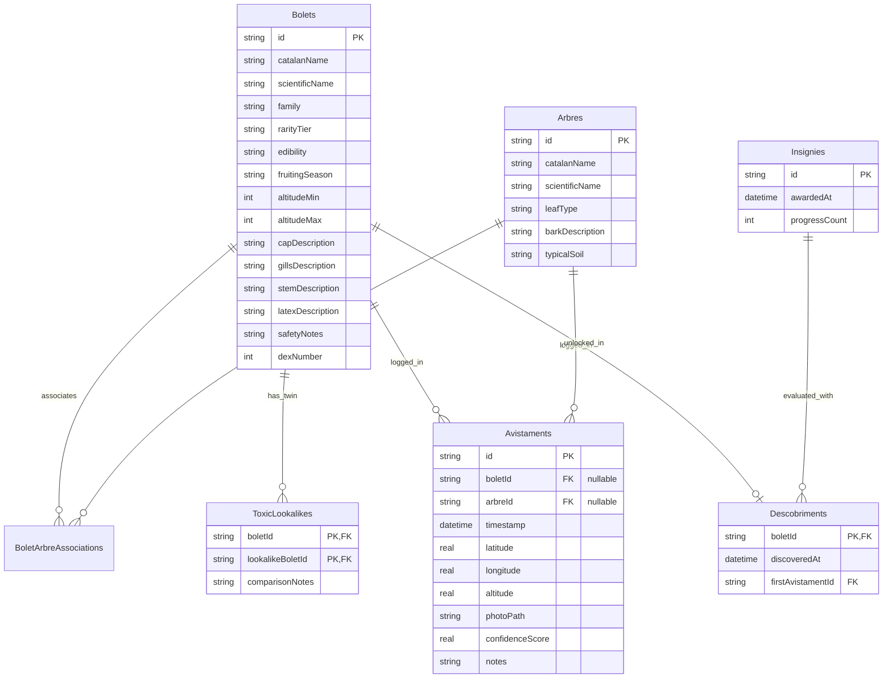

# Data Models & Relational Schema

Boscdex uses **Drift** (a compile-time type-safe SQLite ORM for Dart) to manage all relational data offline.

---

## 🗄️ Relational Entity-Relationship Diagram

---

## 📋 Table Descriptions

### 1. `bolets`
Contains botanical descriptions, morphological attributes (*barret, làmines, peu, làtex*), altitudinal ranges, fruiting calendar months (stored as JSON array), and official culinary classification (`excellent`, `comestible`, `sense_valor`, `toxic`, `mortal`).

### 2. `arbres`
Catalan indicator trees (*Pi roig, Alzina, Suro, Faig, Castanyer*) that form mycorrhizal mutualisms with fungi. Stores leaf type, bark structure, and typical soil acidity/substrates.

### 3. `bolet_arbre_associations`
Junction table linking mushroom species to their symbiotic partner trees with composite primary key `(boletId, arbreId)`.

### 4. `toxic_lookalikes`
Junction table defining dangerous confusion pairs (e.g., *Lactarius deliciosus* vs *Lactarius chrysorrheus*, or *Cantharellus cibarius* vs *Omphalotus olearius*). Stores key diagnostic comparison notes.

### 5. `avistaments`
Chronological sighting logbook entries recording timestamp, optional GPS coordinates, altitude, photo path, ML confidence percentage, and personal field notes. Supports both mushroom sightings (`boletId` set, `arbreId` null) and indicator tree sightings (`arbreId` set, `boletId` null).
* **Schema Version 3 Migration:** Migrated using SQLite zero-loss table recreation under `PRAGMA foreign_keys = OFF` to guarantee `bolet_id` is nullable without constraint failures across existing databases.

### 6. `descobriments`
Tracks whether a species has been registered in the user's Pokédex album. Populated upon the first registered sighting.
* `firstAvistamentId`: Foreign key to `avistaments(id)` configured with `onDelete: KeyAction.setNull`. This guarantees that deleting a sighting entry from the journal gracefully clears the reference without causing SQL foreign key constraint violations or deleting species discovery history.

### 7. `insignies`
Tracks player progression for the 6 field guide badges. Stores the current count (`progressCount`) and timestamp of award (`awardedAt`).
