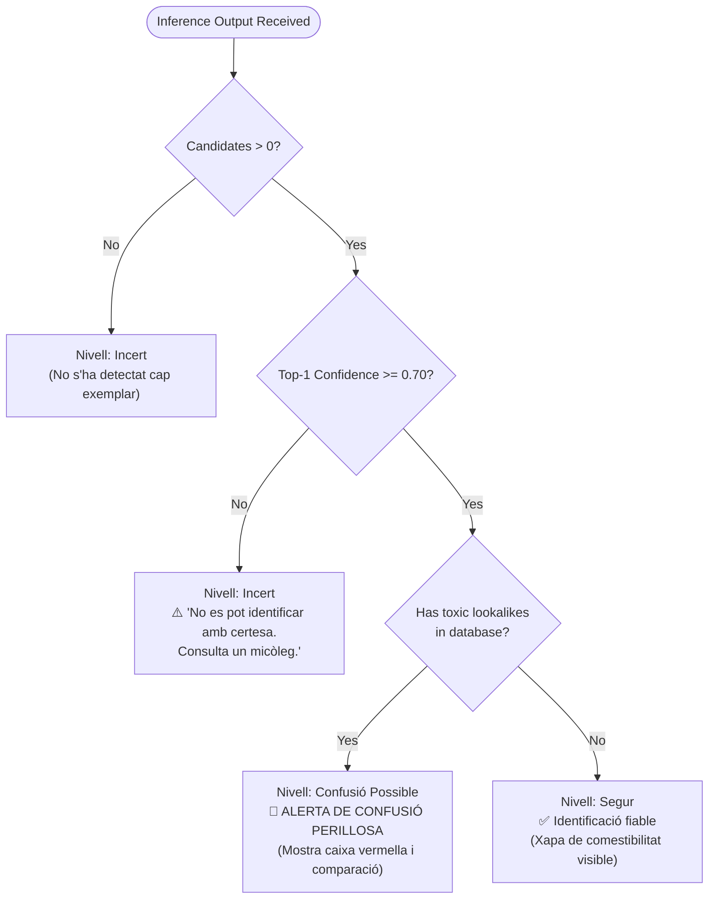

# Safety Gate Decision Flow

Safety is non-negotiable in wild mushroom foraging. The safety gate algorithm acts as a biological firewall protecting users against dangerous ingestion.

---

## 🔀 Decision Tree

---

## 🛡️ Algorithmic Rules

1. **Rule 1 (Confidence Gate):** Any classification with less than $70\%$ certainty is marked `NivellSeguretat.incert`. The app explicitly refuses to give a confident green light on degraded, blurred, or juvenile specimens.
2. **Rule 2 (Toxic Precedence Gate):** If a species is known to have a toxic or deadly lookalike in Catalonia, it **must always** trigger `NivellSeguretat.confusioPossible`, even if the model predicts the edible species with $99\%$ confidence. Visual similarity in nature can deceive even experienced eyes under varying forest lighting.
3. **Rule 3 (Incentivized Education):** Tapping the safety warning box to inspect the morphological differences increases the user's progress toward the **Micòleg Prudent** badge, turning defensive safety into a rewarding game mechanic.
