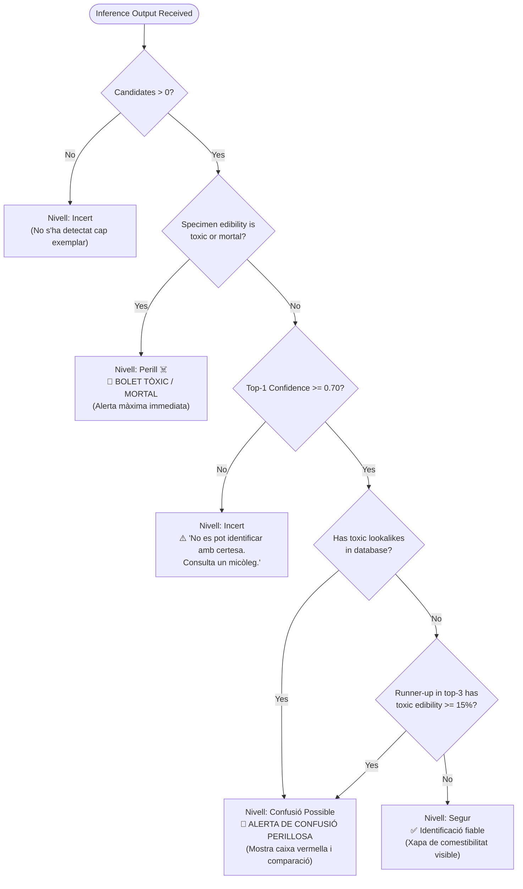

# Safety Gate Decision Flow

Safety is non-negotiable in wild mushroom foraging. The safety gate algorithm acts as a biological firewall protecting users against dangerous ingestion.

---

## 🔀 Decision Tree

---

## 🛡️ Algorithmic Rules

1. **Rule 0 (Life-Safety Toxicity Priority):** If the specimen itself is classified as toxic or mortal, the algorithm immediately returns `NivellSeguretat.perill`. Low neural confidence must **never** suppress an alert on a potentially lethal specimen.
2. **Rule 1 (Confidence Gate):** Any classification with less than $70\%$ certainty is marked `NivellSeguretat.incert`. The app explicitly refuses to give a confident green light on degraded, blurred, or juvenile specimens.
3. **Rule 2 (Toxic Lookalike Precedence Gate):** If a species is known to have a toxic or deadly lookalike in Catalonia (21 cataloged pairs), it **must always** trigger `NivellSeguretat.confusioPossible`, even if the model predicts the edible species with $99\%$ confidence.
4. **Rule 3 (Runner-Up Toxicity Gate):** If any secondary candidate in the top-3 predictions is toxic/mortal with confidence $\ge 15\%$ and top candidate confidence is not overwhelming ($< 88\%$), the gate escalates to `NivellSeguretat.confusioPossible`.
5. **Rule 4 (Incentivized Education):** Tapping the safety warning box to inspect morphological differences fuels the **Micòleg Prudent** (5 views) and **Sentinella del Bosc** (15 views) badges, turning defensive safety into a rewarding game mechanic.
