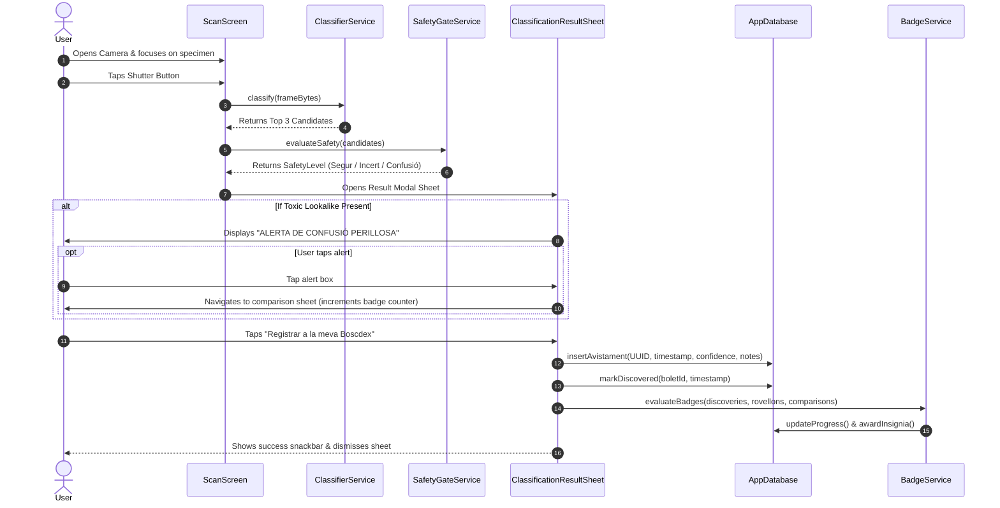

# Scan-to-Log Workflow

This document traces the complete end-to-end journey of a user finding a wild specimen, analyzing it, passing safety checks, unlocking it in the Boscdex, and logging the sighting.

---

## 🧭 Flow Sequence

---

## 🛠️ Step-by-Step Breakdown

1. **Focus & Capture:** The user centers the mushroom cap and stem base in the viewfinder and triggers the shutter.
2. **On-Device Inference:** The frame is downsampled to $224 \times 224$ and passed to the TFLite interpreter. Softmax probabilities yield the top 3 matches.
3. **Safety Evaluation:** `SafetyGateService` checks if confidence $< 0.70$ or if the top species has known poisonous doubles in `toxic_lookalikes`.
4. **Candidate Modal:** Displays the predicted species, confidence bar, edibility badge, and safety alerts.
5. **Persistence & Photo Storage:**
   * High-resolution frame bytes are written to local disk at `<appDocumentsDir>/scans/scan_<uuid>.jpg`.
   * A new row is inserted into `avistaments` with `id`, `boletId`, `timestamp`, `photoPath`, `confidenceScore`, and default notes.
   * `descobriments` is updated with the unlock timestamp and first sighting ID.
   * `BadgeProgressionService` awards milestones (e.g. "Primer Pas al Bosc" or "Caçador de Rovellons").
   * The Boscdex grid reactively transitions the specimen card from a dark silhouette to a full color card with its rarity border.
6. **Journal & Species Captures Synchronization:**
   * **El Meu Diari (`/journal`):** Lists the new entry at the top of the feed with its real field photo thumbnail and `[ XX% ]` confidence pill.
   * **La Boscdex (`/boscdex/:id`):** The mushroom's "Les Teves Captures" gallery immediately renders the newly captured photo card.
   * **Interactive Inspection:** Tapping the sighting anywhere opens `AvistamentDetailSheet`, enabling pinch-to-zoom, confidence breakdown, native sharing, and 1-tap download to the device's photo gallery.
